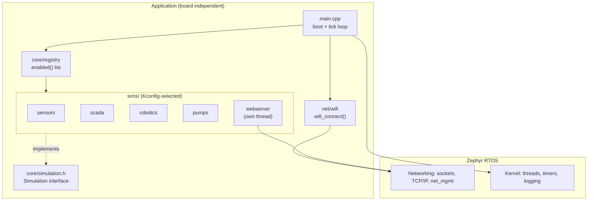
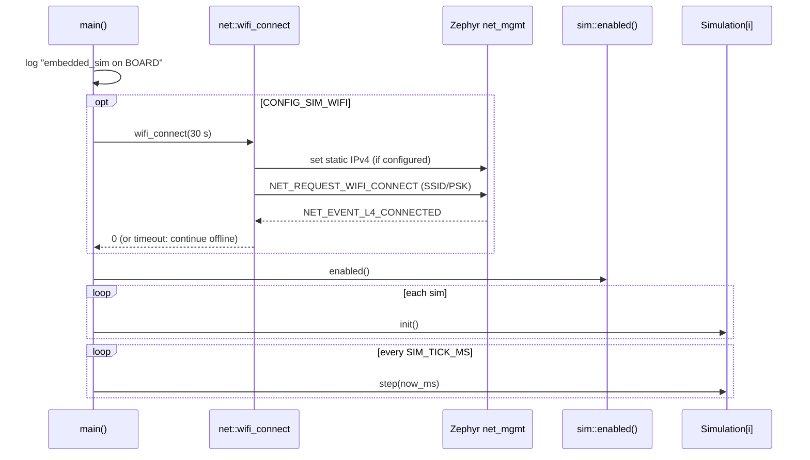
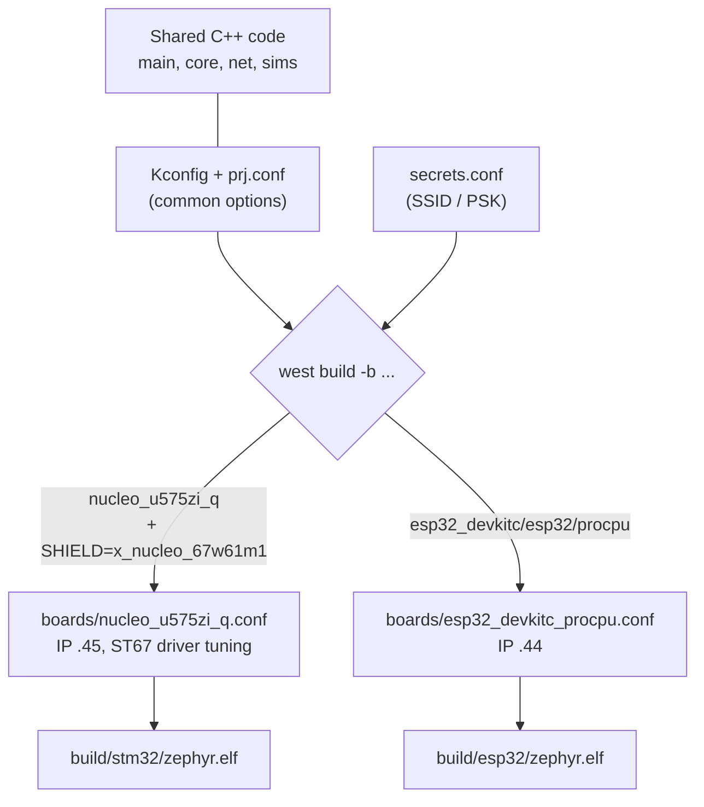

# embedded_sim

A small, portable Zephyr (C++17) application that runs a set of cooperative
"simulation" modules (sensors, SCADA, robotics, pumps, web server) on top of a
common core. The same source tree builds unchanged for two very different Wi-Fi
boards; only per-board config files differ.

| Target | Board | Wi-Fi | Static IP |
|--------|-------|-------|-----------|
| `stm32` | NUCLEO-U575ZI-Q + X-NUCLEO-67W61M1 shield | ST67W611M1 coprocessor over SPI | 192.168.1.45 |
| `esp32` | ESP32-DevKitC (procpu) | native on-chip Wi-Fi | 192.168.1.44 |

Both boards join the configured network at boot and serve a plain-text status
page, e.g. `curl http://192.168.1.45/` ->
`embedded_sim on nucleo_u575zi_q, uptime 12544 ms`.

> **Status:** the framework, Wi-Fi bring-up and web server are working on both
> boards. The `sensors`, `scada`, `robotics` and `pumps` modules are currently
> empty skeletons (`init()`/`step()` do nothing) waiting for real models.

## Repository layout

```
embedded_sim/
├── main.cpp               # boot: join Wi-Fi, init sims, run the tick loop
├── core/
│   ├── simulation.h       # abstract Simulation interface (name/init/step)
│   ├── registry.h/.cpp    # builds the list of sims enabled via Kconfig
├── net/
│   └── wifi.h/.cpp        # board-independent Wi-Fi join + static IPv4 setup
├── sims/                  # one directory per simulation domain
│   ├── sensors/ scada/ robotics/ pumps/   # skeletons
│   ├── webserver/         # TCP :80 status server (needs Wi-Fi)
│   └── CMakeLists.txt     # compiles only the sims enabled in Kconfig
├── boards/                # per-board Kconfig fragments (auto-applied by Zephyr)
│   ├── nucleo_u575zi_q.conf
│   └── esp32_devkitc_procpu.conf
├── scripts/               # env.sh, build.sh, flash.sh, monitor.sh
├── docs/stm32-wifi.md     # one-time coprocessor firmware flashing notes
├── Kconfig  prj.conf  CMakeLists.txt
├── secrets.conf.example   # template for Wi-Fi credentials
└── secrets.conf           # real credentials (gitignored, chmod 600)
```

## Architecture

`main()` is a tiny cooperative scheduler. It optionally joins Wi-Fi, then
`init()`s every enabled simulation once and calls each one's `step(now_ms)`
every `CONFIG_SIM_TICK_MS` (default 100 ms). `step()` must not block; the web
server instead runs its own thread.



### Boot and run-time flow



Adding a simulation: implement `sim::Simulation` in `sims/<name>/<name>.cpp`,
expose a `Simulation &<name>()` factory, add a `CONFIG_SIM_<NAME>` option in
`Kconfig`, and register it in `core/registry.cpp` and `sims/CMakeLists.txt`.

## Portability

Application code never mentions a specific chip. Everything that differs lives
in Zephyr's board support plus a small `boards/<board>.conf` fragment, so the
same `net::wifi_connect()` drives both a native Wi-Fi radio and an SPI
coprocessor through Zephyr's common `wifi_mgmt` API.



### Wi-Fi path on each board


Both radios are 2.4 GHz only, so the access point must broadcast the SSID on
that band.

## Build, flash, monitor

Prerequisites: a Zephyr workspace at `~/zephyrproject` with an `env.sh` (sourced
by `scripts/env.sh`), the Zephyr SDK, `west`, and `pyocd` (STM32) / the ESP32
tooling.

```sh
cp secrets.conf.example secrets.conf      # then edit SSID / PSK; chmod 600
scripts/build.sh stm32 -p always          # or: esp32
scripts/flash.sh stm32                    # STM32 via pyocd, ESP32 via west flash
scripts/monitor.sh stm32                  # serial console, 115200 (ACM0 / USB0)
curl http://192.168.1.45/                 # esp32: 192.168.1.44
```

`secrets.conf` is passed as an extra Kconfig file and is gitignored. Keep it
out of version control.

### Configuration (Kconfig)

| Option | Default | Meaning |
|--------|---------|---------|
| `SIM_SENSORS/SCADA/ROBOTICS/PUMPS` | off (sensors on in `prj.conf`) | enable a simulation |
| `SIM_WEBSERVER` | off (on for both boards) | status server; needs `SIM_WIFI` |
| `SIM_TICK_MS` | 100 | step period |
| `SIM_WEBSERVER_PORT` | 80 | TCP port |
| `SIM_WIFI`, `SIM_WIFI_SSID`, `SIM_WIFI_PSK` | off | join a network at boot (empty PSK = open) |
| `SIM_STATIC_IPV4`, `SIM_GATEWAY_IPV4`, `SIM_NETMASK_IPV4` | -, 192.168.1.1, 255.255.255.0 | static addressing (empty = DHCP) |

## STM32 one-time setup: Wi-Fi coprocessor firmware

The X-NUCLEO-67W61M1 shield must run the **T02** firmware profile (TCP/IP on the
host), NCP fw >= v2.0.106, or Zephyr logs `Did not receive ST67 init over
signal` / `no Wi-Fi interface`. See [docs/stm32-wifi.md](docs/stm32-wifi.md).
The flash **permanently locks the module (eFuses)**. It can be done without
STM32CubeProgrammer using `st-flash` for the host-side binaries and ST's
bundled `QConn_Flash_Cmd-ubuntu` for the NCP.

## Troubleshooting

| Symptom | Cause |
|---------|-------|
| `joining` fails / no connection | `secrets.conf` still has `CHANGE_ME`, or the SSID is not on 2.4 GHz |
| `st67w611m1_spi: Failed to process SPI: -77` | NCP lacks T02 firmware; flash it (above) |
| `no Wi-Fi interface` | shield driver did not start (same as above) or `SHIELD` not set; use `scripts/build.sh` |
