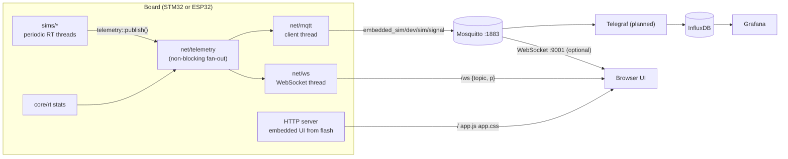
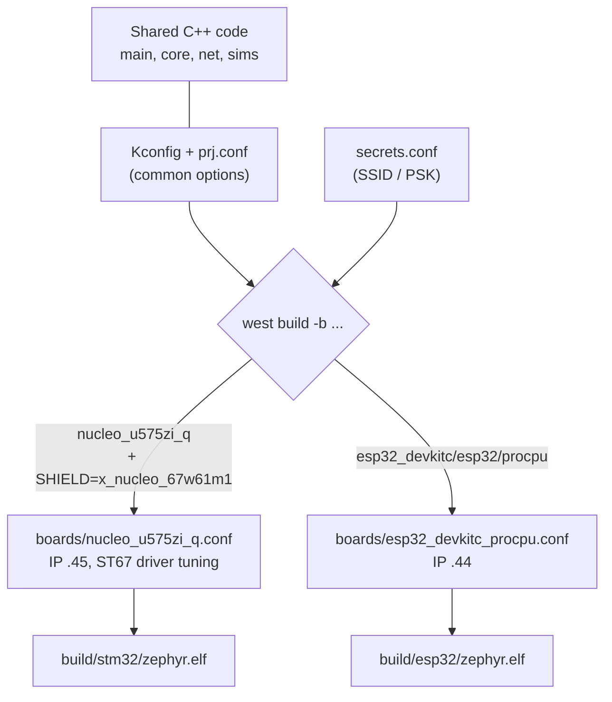
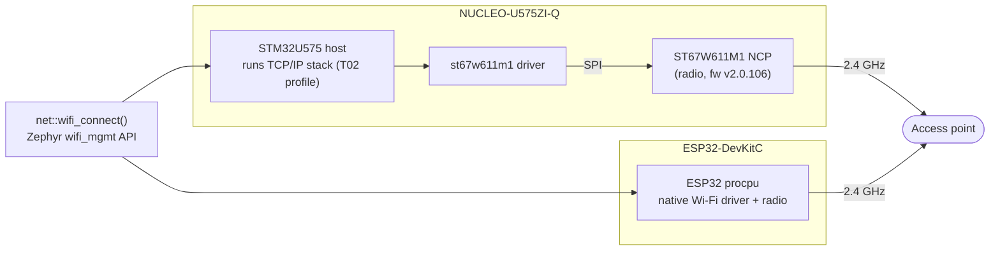

# embedded_sim

A portable Zephyr (C++17) application that runs real-time "simulation" modules
(sensors, SCADA, robotics, pumps) on two boards, publishes their data over
MQTT and a WebSocket, and hosts its own web UI **inside the firmware**, so a
flashed board works on any network or HIL rig without a server. All simulation
runs in real wall-clock time (no accelerated cycles). The same source tree builds
unchanged for two very different Wi-Fi boards; only per-board config differs.

| Target | Board | Wi-Fi | Static IP | Device id |
|--------|-------|-------|-----------|-----------|
| `stm32` | NUCLEO-U575ZI-Q + X-NUCLEO-67W61M1 shield | ST67W611M1 coprocessor over SPI | 192.168.1.45 | `stm32-01` |
| `esp32` | ESP32-DevKitC (procpu) | native on-chip Wi-Fi | 192.168.1.44 | `esp32-01` |

Open `http://192.168.1.45/` or `http://192.168.1.44/` for the live UI
(Overview, Charts, Real-time, Console, Settings).

> **Status (what works, verified on hardware)**
> - Wi-Fi on both boards, static IPs, secrets kept out of git.
> - Real-time core (`core/rt`): per-sim periodic threads, drift-free deadlines,
>   jitter/overrun stats (logged and published).
> - MQTT telemetry to the local Mosquitto (auth, auto-reconnect, last-will status).
> - Device-hosted web UI + live WebSocket on both boards; MQTT-over-WebSocket as
>   an optional second source.
> - Not yet built: the `scada`, `robotics`, `pumps` models (empty skeletons; `sensors`
>   emits a placeholder `demo_temp`), TLS, secure boot, OTA, the `utils/` codegen.
>   What exists is documented with diagrams in [docs/architecture.md](docs/architecture.md);
>   the proposed next steps are in [docs/roadmap.md](docs/roadmap.md).

## Repository layout

```
embedded_sim/
├── main.cpp               # boot: Wi-Fi, init sims, start RT runner + sinks, report timing
├── core/
│   ├── simulation.h       # Simulation interface: name/init/step(Tick)/period_ms/priority
│   ├── registry.*         # list of sims enabled via Kconfig
│   └── rt/                # real-time runner: periodic thread per sim, jitter/overrun stats
├── net/
│   ├── wifi.*             # board-independent Wi-Fi join + static IPv4
│   ├── telemetry.*        # bus: sims publish(), MQTT/WebSocket sinks consume
│   ├── mqtt/              # topic builders, JSON payloads, reconnecting client
│   └── ws/                # HTTP service (embedded UI files) + WebSocket fan-out
├── web/                   # frontend (TypeScript + Vite) -> dist/ -> embedded in firmware
│   └── fallback/          # tiny built-in page used when web/dist is not built
├── sims/                  # one directory per simulation domain (Kconfig-selected)
│   ├── sensors/ scada/ robotics/ pumps/
│   └── webserver/         # starts the HTTP/WebSocket server (net/ws)
├── boards/                # per-board Kconfig fragments (auto-applied by Zephyr)
├── scripts/               # env, build, flash, monitor, web-build, web-dev
├── docs/                  # architecture, mqtt, web, stm32-wifi
├── Kconfig  prj.conf  CMakeLists.txt
├── secrets.conf.example   # template: Wi-Fi + MQTT credentials
└── secrets.conf           # real credentials (gitignored, chmod 600)
```

## Architecture

`main()` joins Wi-Fi, `init()`s every enabled simulation once, starts the sinks and
hands the sims to the real-time core (`core/rt`). Each simulation runs in its own
thread at its own `period_ms()`/`priority()`, on drift-free absolute deadlines, in
real wall-clock time. `step(const rt::Tick&)` gets the actual start time and the
nominal `dt`. Overruns skip missed deadlines (counted, never queued); per-task
jitter/exec stats are logged and published every `SIM_STATS_PERIOD_S`.
Simulations publish measurements through the **telemetry bus**; they never talk
to MQTT or the web UI directly.

### Data path



The browser merges the device WebSocket (always available) with the optional broker
feed, dropping duplicates by device uptime. Details: [docs/mqtt.md](docs/mqtt.md),
[docs/web.md](docs/web.md).

### Components


### Boot and run-time flow


Adding a simulation: implement `sim::Simulation` in `sims/<name>/<name>.cpp`,
expose a `Simulation &<name>()` factory, add a `CONFIG_SIM_<NAME>` option in
`Kconfig`, and register it in `core/registry.cpp` and `sims/CMakeLists.txt`.

## Portability

Application code never mentions a specific chip. Everything that differs lives
in Zephyr's board support plus a small `boards/<board>.conf` fragment, so the
same `net::wifi_connect()` drives both a native Wi-Fi radio and an SPI
coprocessor through Zephyr's common `wifi_mgmt` API.



### Wi-Fi path on each board



Both radios are 2.4 GHz only, so the access point must broadcast the SSID on
that band.

## Build, flash, monitor

Prerequisites: a Zephyr workspace at `~/zephyrproject` with an `env.sh` (sourced
by `scripts/env.sh`), the Zephyr SDK, `west`, and `pyocd` (STM32) / the ESP32
tooling.

```sh
cp secrets.conf.example secrets.conf      # edit SSID/PSK + MQTT user/password; chmod 600
scripts/web-build.sh                      # frontend -> web/dist (needs: sudo apt install nodejs npm)
scripts/build.sh stm32 -p always          # or: esp32
scripts/flash.sh stm32                    # STM32 via pyocd, ESP32 via west flash
scripts/monitor.sh stm32                  # serial console, 115200 (ACM0 / USB0)
# open http://192.168.1.45/  (esp32: 192.168.1.44)
```

`secrets.conf` is passed as an extra Kconfig file and is gitignored. Keep it
out of version control.

### Configuration (Kconfig)

| Option | Default | Meaning |
|--------|---------|---------|
| `SIM_SENSORS/SCADA/ROBOTICS/PUMPS` | off (sensors on in `prj.conf`) | enable a simulation |
| `SIM_WEBSERVER` | on for both boards | device-hosted UI + WebSocket (needs `SIM_WIFI`) |
| `SIM_WEBSERVER_PORT`, `SIM_WS_MAX_CLIENTS`, `SIM_WS_QUEUE_LEN` | 80, 3, 16 | HTTP port, viewers, queue |
| `SIM_DEFAULT_PERIOD_MS` | 100 | default period (a sim can override `period_ms()`) |
| `SIM_MAX_TASKS`, `SIM_TASK_STACK_SIZE` | 8, 2048 | simulation thread slots / stack |
| `SIM_STATS_PERIOD_S` | 10 | log real-time stats (0 = off) |
| `SIM_MQTT`, `SIM_MQTT_BROKER/PORT/USER/PASSWORD` | on for both boards, 192.168.1.147:1883 | MQTT telemetry, see [docs/mqtt.md](docs/mqtt.md) |
| `SIM_DEVICE_ID` | per board | device segment in topics and MQTT client id |
| `SIM_WEBSERVER_PORT` | 80 | TCP port |
| `SIM_WIFI`, `SIM_WIFI_SSID`, `SIM_WIFI_PSK` | off | join a network at boot (empty PSK = open) |
| `SIM_STATIC_IPV4`, `SIM_GATEWAY_IPV4`, `SIM_NETMASK_IPV4` | -, 192.168.1.1, 255.255.255.0 | static addressing (empty = DHCP) |

## STM32 one-time setup: Wi-Fi coprocessor firmware

The X-NUCLEO-67W61M1 shield must run the **T02** firmware profile (TCP/IP on the
host), NCP fw >= v2.0.106, or Zephyr logs `Did not receive ST67 init over
signal` / `no Wi-Fi interface`. See [docs/stm32-wifi.md](docs/stm32-wifi.md).
The flash **permanently locks the module (eFuses)**. It can be done without
STM32CubeProgrammer using `st-flash` for the host-side binaries and ST's
bundled `QConn_Flash_Cmd-ubuntu` for the NCP.

## Troubleshooting

| Symptom | Cause |
|---------|-------|
| `joining` fails / no connection | `secrets.conf` still has `CHANGE_ME`, or the SSID is not on 2.4 GHz |
| `st67w611m1_spi: Failed to process SPI: -77` | NCP lacks T02 firmware; flash it (above) |
| `no Wi-Fi interface` | shield driver did not start (same as above) or `SHIELD` not set; use `scripts/build.sh` |
| `CONNACK refused: 5` / broker log `not authorised` | wrong `SIM_MQTT_USER/PASSWORD` in `secrets.conf` (check it is not placeholder text) |
| Mosquitto container restarts, `Unable to open pwfile` | `passwd` must be owned by uid 1883: `sudo chown 1883:1883 ~/stack/mosquitto/config/passwd` |
| ESP32 build: `region dram0_0_seg overflowed` | embedded web files must be `static const` in `net/ws/service.c` (non-const copies them into RAM); inspect with `ninja -C build/esp32 ram_report` |
| `connection lost (-11)` every ~15 s | `mqtt_live()` returns `-EAGAIN` when no ping is due; it is not an error (fixed in `net/mqtt/client.cpp`) |
| ESP32 intermittently unreachable (`No route to host`) | Wi-Fi modem sleep drops ARP/TCP; `ESP32_WIFI_STA_POWER_SAVE_NONE=y` is set in the board conf |
| Browser: Broker chip stays red | Mosquitto has no WebSocket listener on 9001, see [docs/web.md](docs/web.md); the Device chip is independent |
| UI is the tiny fallback page | `web/dist` was not built when the firmware was built: run `scripts/web-build.sh`, then rebuild |
| Web UI hangs or loads only sometimes (ping works, curl works) | browsers hold parallel keep-alive connections plus the WebSocket; `HTTP_SERVER_MAX_CLIENTS=6` and a 3 s inactivity timeout are set in `prj.conf` to avoid running out of slots |
