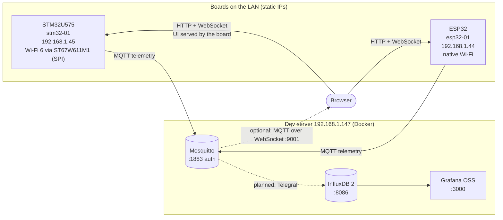
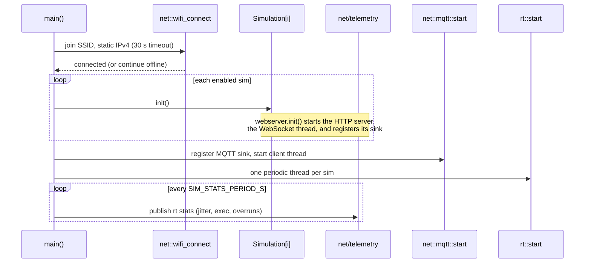
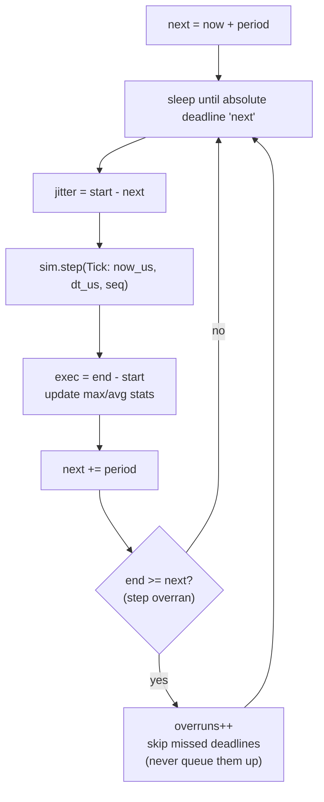
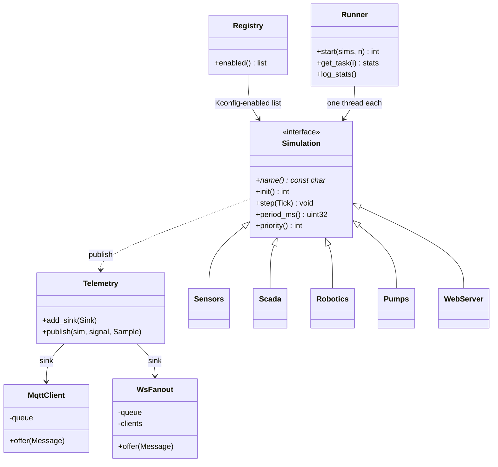
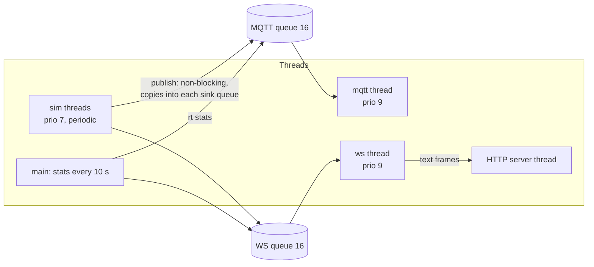
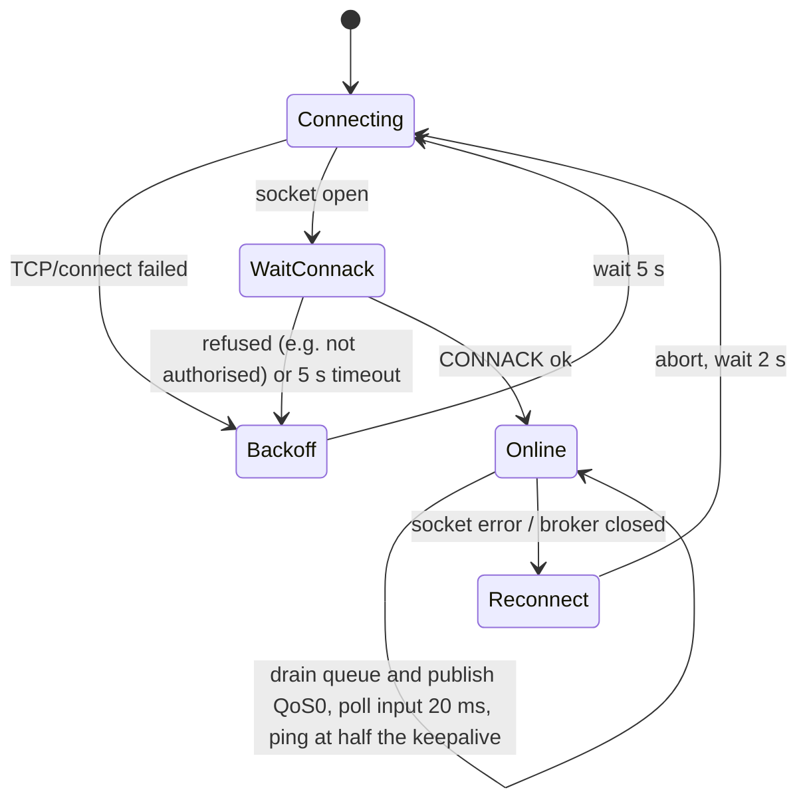
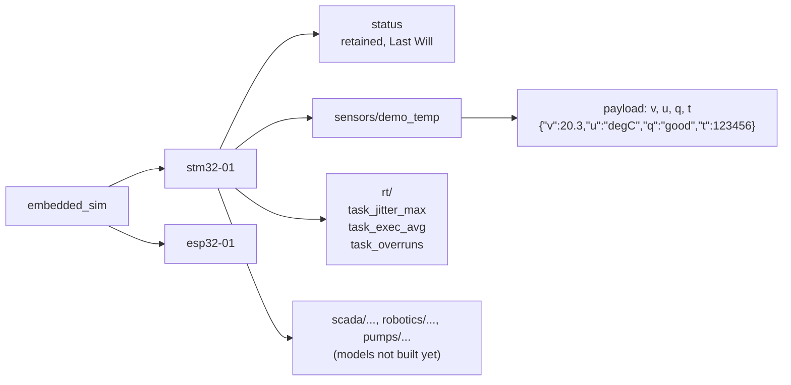
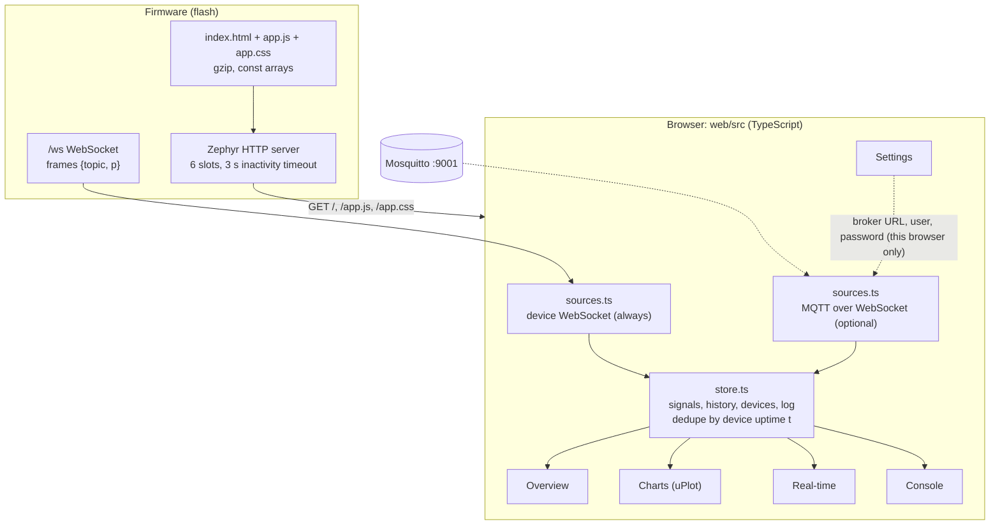
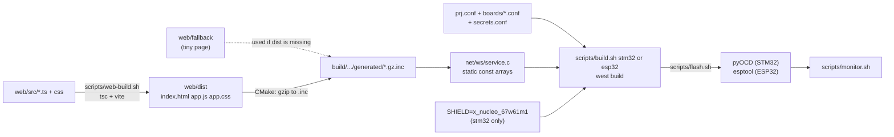
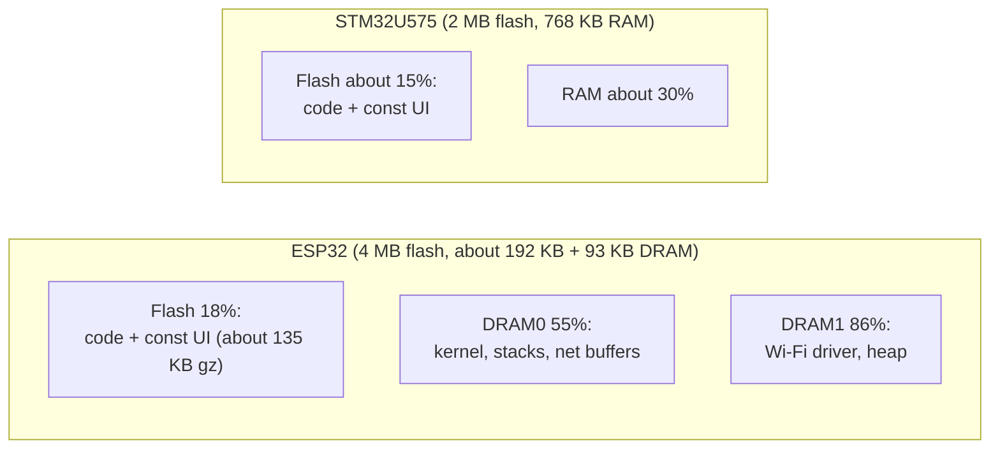

# Architecture (as built)

Everything on this page exists in the repo and has been verified on both boards
(NUCLEO-U575ZI-Q + X-NUCLEO-67W61M1, ESP32-DevKitC) unless marked otherwise.
Planned work lives in [roadmap.md](roadmap.md).

Principle: everything runs in **real wall-clock time** on the MCU, like a real
PLC/RTU. No accelerated or Simulink-style time.

Contents: [System](#1-system-overview) · [Boot](#2-boot-sequence) ·
[Real-time core](#3-real-time-core) · [Telemetry bus](#4-telemetry-bus-and-threads) ·
[MQTT](#5-mqtt-client) · [Topics](#6-topic-and-payload-model) ·
[Web UI](#7-web-ui) · [Build pipeline](#8-build-and-flash-pipeline) ·
[Memory](#9-memory-layout) · [Lessons](#10-platform-notes-and-lessons)

## 1. System overview

Solid lines work today. The boards are self-sufficient: the UI and live data
come straight from the board, so the server is optional (it only adds history
and dashboards).

## 2. Boot sequence

Sinks are registered before the real-time threads start, so the sink list is
never modified while sims are publishing.

## 3. Real-time core

`core/rt` runs each simulation in its own thread on absolute deadlines.

| Rule | Why |
|------|-----|
| Deadlines advance by exactly one period | no drift, like a PLC scan cycle |
| Missed deadlines are skipped and counted | a slow step cannot cause a burst of catch-up steps |
| `dt` is the nominal period | models integrate with a fixed step in real time |
| Each sim declares `period_ms()` and `priority()` | fast loops (robotics) and slow ones (SCADA) coexist |

Measured so far (empty sims): `over=0`; jitter 0-6 ms, dominated by the kernel
tick. Sub-millisecond loops need a faster tick (see [roadmap](roadmap.md)).

## 4. Telemetry bus and threads

Simulations never talk to MQTT or the web UI. They call one function; sinks
decide where the data goes.

A full queue drops the sample and counts it. A slow network can never stall a
simulation thread.

## 5. MQTT client

On connect the client publishes a retained `online` status. The broker
publishes the retained `offline` Last Will if the board vanishes.

## 6. Topic and payload model

Full spec: [mqtt.md](mqtt.md).

One topic per signal, flat JSON. Telegraf can take `device`, `sim` and `signal`
tags straight from the topic. The device has no RTC, so `t` is uptime and the
ingester stamps wall-clock time.

## 7. Web UI

The UI lives **in the firmware**, so a flashed board works on any network or HIL
rig with no server.

Screenshots of every tab: [web.md](web.md#tour-of-the-ui).

| Tab | Shows |
|-----|-------|
| Overview | live tile per signal, device online/offline, board, uptime |
| Charts | one live chart per numeric signal (600 points) |
| Real-time | per-task jitter, exec time, overruns (red when a deadline was missed) |
| Console | raw frames with filter, pause, clear |
| Settings | optional MQTT broker as a second source |

## 8. Build and flash pipeline

## 9. Memory layout

Measured on 2026-10-10 with the UI embedded. The ESP32's RAM is the scarce
resource, not flash.

Rule: anything embedded must be `static const` so it lands in flash. A
non-`const` copy of the UI once pushed the ESP32 over its DRAM limit.

## 10. Platform notes and lessons

| Topic | Note |
|-------|------|
| ESP32 RAM | keep embedded files `const`; inspect with `ninja -C build/esp32 ram_report` |
| Wi-Fi power save | off on ESP32 (`ESP32_WIFI_STA_POWER_SAVE_NONE`): modem sleep drops ARP/TCP |
| First boot after flashing | ESP32 may need one press of EN before it is reachable (cause not found) |
| HTTP server | experimental in Zephyr 4.5-rc1; macros are C-only, so `net/ws/service.c` is the one C file |
| Browser connections | parallel keep-alive + WebSocket need `HTTP_SERVER_MAX_CLIENTS=6` |
| MQTT keepalive | `mqtt_live()` returns `-EAGAIN` when no ping is due; not an error |
| STM32 Wi-Fi | ST67W611M1 needs one-time T02 firmware (locks the module): [stm32-wifi.md](stm32-wifi.md) |
| Kernel tick | coarse; jitter of 1-5 ms observed on ESP32 |
| WebSocket viewers | Zephyr default is ONE websocket system-wide: extra viewers were upgraded then closed at once. `WEBSOCKET_MAX_CONTEXTS=8`, `SIM_WS_MAX_CLIENTS=4`; when full, `net/ws/ws.cpp` evicts the oldest viewer (stale tabs/phones that left the Wi-Fi are only noticed when a send fails) |
