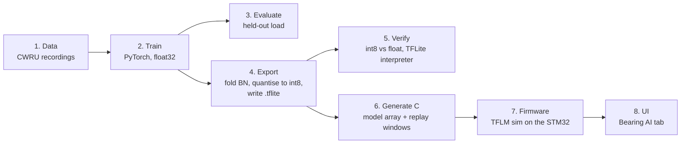
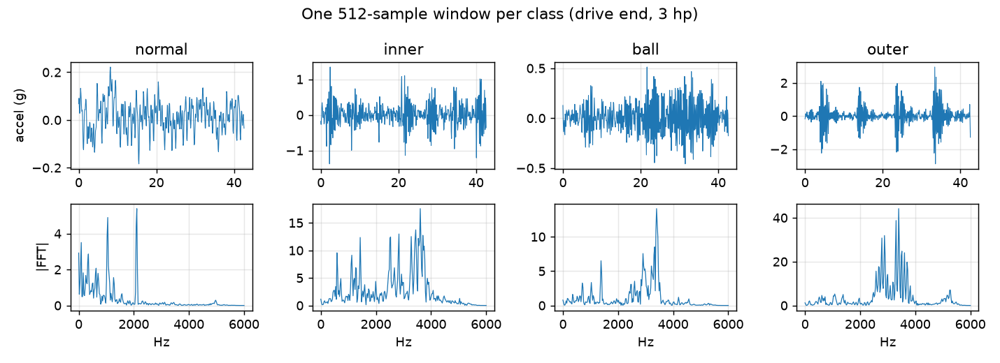
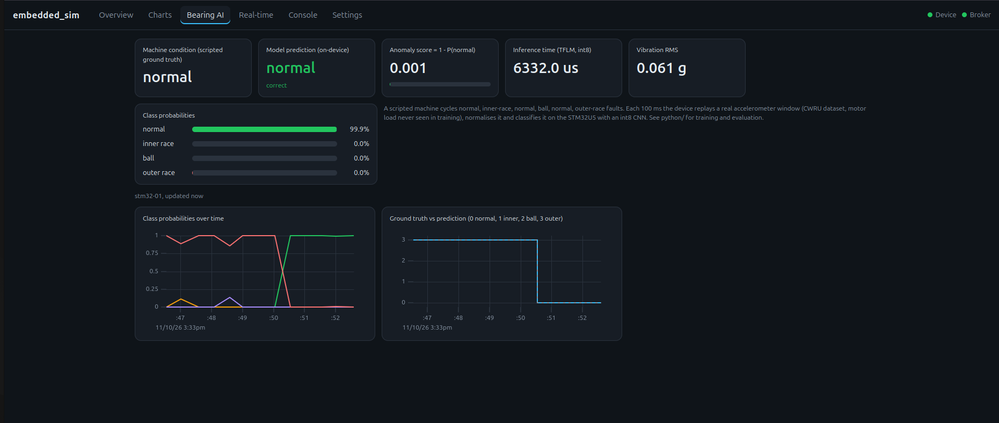

# How the embedded AI simulation was built

A walkthrough for learning: what was done, in what order, why each choice was made,
what went wrong, and how to change it. Companion to [python/README.md](../python/README.md)
(the results) and the [Embedded AI section of the README](../README.md#embedded-ai-bearing-condition-on-the-stm32u5).

## 0. The goal, and the decisions that shaped everything

Goal: put a neural network *on the STM32U5 board*, fed by a simulator, visible in the UI.
Four decisions were made up front (the first three were your answers to my questions):

| Decision | Choice | Why it matters |
|---|---|---|
| Use case | Vibration anomaly / bearing condition | Fits the pumps/SCADA direction; a public benchmark exists; small models work |
| Inference runtime | TensorFlow Lite Micro (TFLM) | Open source, builds inside the existing Zephyr flow, int8 + Arm CMSIS-NN kernels |
| Training stack | PyTorch -> ONNX -> TFLite | Nicer training code than Keras; ONNX is the neutral exchange format |
| Where the data comes from | **Replayed real recordings** | The Nucleo has no accelerometer; the "sim" plays dataset windows in real time |

Key idea to keep in mind: **training happens once, on a PC, in float. The board only ever
runs inference, in int8.** Everything between those two is "export".



## 1. Data: what the model learns from

A bearing in a motor or pump produces vibration. A damaged bearing produces *repeating
impacts* (each time a rolling element hits the damage), which show up as a different
pattern in the accelerometer signal. The
[CWRU bearing data](https://engineering.case.edu/bearingdatacenter) is the standard public
benchmark: a test rig with deliberately damaged bearings (faults put on the inner race, the
balls, or the outer race, three sizes each) recorded at four motor loads.

I downloaded 40 recordings (`python/data/fetch_cwru.py`, 134 MB). The file numbers per class
come from the CWRU file index; a manifest in the script maps each id to
`(class, fault size, load)`. The figure below (made by `evaluate.py`) shows what the model
sees: the outer-race fault has clear periodic bursts, the healthy bearing does not.



**Windows.** The network does not take a whole recording; it takes a short *window*:
512 samples = 42.7 ms at 12 kHz. The firmware does the same: one window per inference.

**Normalisation.** Each window is z-scored (subtract its mean, divide by its standard
deviation). That removes amplitude, so the model cannot cheat by learning "this motor load is
louder". The *same* maths is in `python/bearing/data.py::normalise` and
`sims/bearing_ai/bearing_ai.cpp::step`. If these two ever disagree, accuracy silently drops:
the classic embedded-ML bug.

**The split that matters.** I trained on loads 0, 1, 2 hp and tested on 3 hp. A random split
of windows would be wrong: neighbouring windows overlap and look nearly identical, so
"test" windows would leak into training and the score would look great for the wrong reason.
Splitting by *operating condition* asks the real question: *does it still work on a
condition it has never seen?*

## 2. The model

```
input (512)  ->  Conv k16 s4, 8ch  ->  Conv k8 s2, 16ch  ->  Conv k8 s2, 32ch
             ->  mean over time  ->  Linear 32->4  ->  [normal, inner, ball, outer]
```

* 5,548 parameters, 183 k multiply-accumulates: tiny on purpose, so it fits and runs fast
  on a microcontroller. Every convolution is followed by BatchNorm and ReLU.
* **Designed around TFLM.** I used only operations TFLM implements well (`CONV_2D`, `MEAN`,
  `FULLY_CONNECTED`). A 1-D convolution is expressed as a 2-D convolution with width 1. The
  firmware registers only these three ops (`MicroMutableOpResolver<3>`), so the library
  pulls in no unused kernels.
* One model gives both outputs you asked about: the **fault type** (argmax) and an
  **anomaly score** (`1 - P(normal)`).
* Training (`train.py`): AdamW, one-cycle learning rate, class-balanced sampling, a little
  noise augmentation, 25 epochs, about 8 minutes on this CPU.

## 3. Evaluation (what "good" means)

On the held-out 3 hp load (3,091 windows, never seen in training):

| Model | Accuracy | Anomaly AUROC |
|---|---|---|
| PyTorch float32 | 95.4 % | 1.000 |
| ONNX Runtime | 95.4 % | 1.000 |
| TFLite int8 (on the board) | 94.9 % | 1.000 |

How to read it:

* **AUROC 1.0** means that ranking windows by anomaly score perfectly separates healthy from
  faulty. In practice you pick a threshold (the UI colours the score red above 0.5).
* **Accuracy 95 %** is the 4-way fault-type result. The confusion matrix shows where it
  fails: inner-race faults are labelled `ball` 21 % of the time. Detecting *that* a bearing
  is damaged is easy here; telling *which part* is harder.
* The ONNX row equals the PyTorch row: that proves the ONNX export is faithful. The int8 row
  is 0.5 points lower: that is the cost of quantisation (next section).

Honest limits: CWRU is clean lab data from one machine, and I did not test unseen fault
*sizes*. This demonstrates the on-device pipeline; it is not a validated maintenance product.

## 4. Export: from PyTorch to something a microcontroller can run

### 4a. Why int8

A float32 weight takes 4 bytes and needs a floating-point multiply; an int8 weight takes 1
byte and uses cheap integer instructions (and Arm's CMSIS-NN uses the Cortex-M33's SIMD for
them). Quantisation maps each float tensor `x` to an integer `q` with `x ~ scale * (q - zero_point)`.
The scheme TFLM expects:

| Tensor | Scheme |
|---|---|
| activations | per-tensor, asymmetric int8 (scale + zero point) |
| conv weights | per-output-channel, symmetric (zero point 0) |
| fc weights | per-tensor, symmetric |
| biases | int32, scale = input scale x weight scale |

**Calibration.** Scales for activations come from running ~4,000 training windows through
the float model and recording each layer's value range (clipped at the 99.9th percentile so a
single huge spike does not waste resolution). This is *post-training quantisation*.

**BatchNorm folding.** At inference BatchNorm is just a per-channel scale and shift, so it is
merged into the preceding convolution's weights and bias. The device never sees BatchNorm.

### 4b. The detour: why `export.py` writes the .tflite by hand

The usual route (`onnx2tf` or Google's `ai-edge-torch`) needs TensorFlow. I installed it and
it crashed on import with **"Illegal instruction"**. Cause: this machine's CPU (Celeron
N5095) has no AVX, and TensorFlow's prebuilt wheels require it. (`grep avx /proc/cpuinfo`
showed nothing.)

Options were: build TensorFlow from source (hours), move to another machine, or skip
TensorFlow. Because the model is only three op types, I took the third route:
`export.py` does the quantisation itself and writes the TFLite flatbuffer using the schema
classes bundled with `ai-edge-litert` (a small runtime that does *not* need AVX).

**How I know the hand-written file is correct:** `evaluate.py` runs it through the reference
TFLite interpreter. It loads, runs, and agrees with the float model on 99.45 % of windows. If
the file were malformed or mis-quantised the interpreter would reject it or the accuracy
would collapse. On a machine with AVX you can swap `export.py` for `onnx2tf`; nothing else
changes. `export.py` also writes the ONNX file (`artifacts/bearing_cnn.onnx`) for portability.

### 4c. From file to firmware

`gen_firmware.py` writes two C sources into `sims/bearing_ai/gen/`:

* `model_data.cc/.h`: the `.tflite` bytes as a C array (9,008 bytes, stored in flash), plus the
  input/output quantisation constants.
* `window_bank.h`: 32 raw windows (8 per class) from the held-out load, as int16. They are
  *raw* (not normalised) so the firmware exercises the real preprocessing too.

## 5. Firmware: the `bearing_ai` simulation

It follows the repo's existing pattern: a class implementing `sim::Simulation`, registered
in `core/registry.cpp`, selected by Kconfig (`SIM_BEARING_AI`), added to `sims/CMakeLists.txt`.
Each 100 ms tick (`sims/bearing_ai/bearing_ai.cpp`):

1. **Pick the window.** A scripted schedule (`normal, inner, normal, ball, normal, outer`,
   15 s each, `SIM_BEARING_AI_DWELL_S`) decides the true condition; a window of that class is
   taken from the bank.
2. **Preprocess.** Mean/standard deviation, z-score, then quantise to int8 with the model's
   input scale and zero point, straight into TFLM's input tensor.
3. **Invoke** the TFLM interpreter (timed with the cycle counter).
4. **Postprocess.** Dequantise the 4 logits, softmax in float, argmax.
5. **Publish** (every 5th tick = 2 Hz) via `net::telemetry::publish`: `p_normal`, `p_inner`,
   `p_ball`, `p_outer`, `anomaly_score`, `predicted_class`, `true_class`, `infer_us`, `vib_rms`.
   The existing MQTT and WebSocket sinks carry them with no changes.

TFLM concepts worth knowing:

* **Tensor arena.** TFLM never calls `malloc`. You give it one static byte array (24 KiB
  here) and `AllocateTensors()` plans all intermediate buffers inside it. The log reports the
  real need: **4,068 bytes**, so 24 KiB is generous and could shrink.
* **Op resolver.** Lists which kernels to link. Fewer ops = smaller flash.
* The Zephyr option `TENSORFLOW_LITE_MICRO_CMSIS_NN_KERNELS` swaps the reference kernels for
  Arm's optimised ones.

### Getting TFLM into the build (the painful part)

TFLM is not in the default Zephyr workspace. `scripts/setup-tflm.sh` fetches it, and
`scripts/build.sh` passes it to Zephyr as an extra module. It took four attempts, which is
worth understanding because it is a typical "version skew" problem:

| Attempt | Failure | Cause |
|---|---|---|
| clone default branch `zephyr` | `Cannot find source file .../error_reporter.cc` | Zephyr 4.5-rc1's CMake lists files newer than this branch |
| branch `main` | Kconfig: `TENSORFLOW_LITE_MICRO ... has direct dependencies n` | `main` has no `zephyr/module.yml`, so Zephyr never registered it as a module |
| `zephyr-v4.4.0` | `Cannot find .../basic_classifier.cc` | too old for Zephyr 4.5 |
| `main` + generated `module.yml` | `flatbuffers/flatbuffers.h: No such file` | `main` also lacks `third_party_static/` (flatbuffers, gemmlowp, ruy, kissfft headers) |

Final fix: take `main`, add the 3-line `module.yml`, and copy `third_party_static/` from
`zephyr-v4.4.0`. It is scripted so it is reproducible, and commented for removal when
Zephyr 4.5 final lands. Lesson: when a module's glue lives in one repo (Zephyr) and the code in
another (the TFLM fork), their versions must match; read the error, find which side is
newer.

Also needed: the simulation threads had a 2 KiB stack, too small for TFLM, so
`boards/nucleo_u575zi_q.conf` sets `CONFIG_SIM_TASK_STACK_SIZE=6144` for the STM32 only.

### Verifying on hardware

Built (445 KB flash = 21 %, 177 KB RAM = 22.5 %), flashed with `scripts/flash.sh stm32`, and
read the serial console:

```
sim_bearing_ai: model 9008 B, arena used 4068 of 24576 B, input scale 0.03589 zp -3
rt: bearing_ai T=100ms runs=99 over=0 jitter_max=0us exec_avg=8422us
```

The model loaded, ran 99 times in 10 s with **no missed deadlines**, and the published
`infer_us` is 6.3 ms per inference (the other ~2 ms of the step is the float preprocessing).
Then I opened a raw WebSocket to the board and watched the live frames: the predicted class
followed the scripted truth through the transitions.

My first flash had no Wi-Fi: the log said `joining ''`. The worktree I built in did not have
`secrets.conf` (it is git-ignored, so it only exists in your main checkout). Copying it in
and rebuilding fixed it. A good reminder that ignored files are not part of a git checkout.

## 6. The UI

The existing UI is generic: it auto-creates a tile and chart for every signal it sees. The 9 new
signals would have swamped the Overview, so:

* `web/src/bearing.ts` adds a dedicated **Bearing AI** tab: ground truth vs prediction,
  anomaly meter, class-probability bars, inference time, vibration RMS, and two charts
  (probabilities over time; true vs predicted class).
* `views.ts` hides `bearing_ai` from the generic Overview/Charts; `main.ts` registers the tab;
  `style.css` has the new styles.
* The chart helper aligns the series on the shortest history, so one dropped sample cannot
  skew the lines.



(The light-theme capture, taken during verification, is `img/ui-bearing-ai.png`.)

I verified it by driving the real page on the real board with a headless browser (Playwright),
clicking the tab and reading the values: no console errors, and the screenshot in the
README is from that run. It also shows the model's weak spot honestly: during the inner-race
phase the prediction flickers between `inner` and `ball`, exactly what the 79 % recall predicts.

## 7. How to change things

| I want to... | Do this |
|---|---|
| Retrain / change the model | edit `python/bearing/model.py`, then `train.py`, `export.py`, `evaluate.py`, `gen_firmware.py`, rebuild. If you change the layer *types*, also add the op to the resolver in `bearing_ai.cpp` and handle it in `export.py` |
| Use your own sensor data | replace `data.py` loading; keep the 512-sample window and the z-score, or change `WIN` everywhere |
| Run on a live sensor | replace the window-bank read in `step()` with an ADC/IMU DMA buffer; the rest stays |
| Slow down / speed up the demo | `CONFIG_SIM_BEARING_AI_DWELL_S` |
| Port to the ESP32 | TFLM supports Xtensa; enable `SIM_BEARING_AI` in the ESP32 conf (untested; mind the 86 % DRAM use noted in the roadmap) |
| Make inference faster | the 6.3 ms is slow for 183 k MACs because the kernels are `k x 1` with 1 input channel; try a spectral input (FFT, then a dense net) or check the board clock and CMSIS-NN use |

## 8. What was *not* done (so you know the boundaries)

* No test on unseen fault sizes or other machines; CWRU only.
* TLS/auth, MQTT dashboards and Grafana for the new signals are untouched (the signals
  already flow over MQTT per the existing topic convention).
* Not tested on the ESP32.
* Inference timing was measured on the board as shipped; no clock/optimisation tuning.
* The training run is one seed; no confidence intervals.
