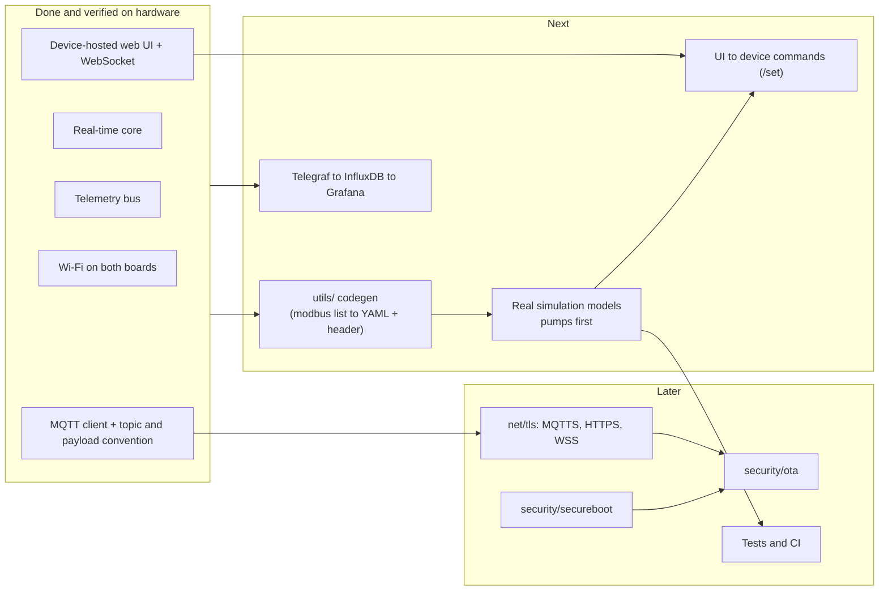
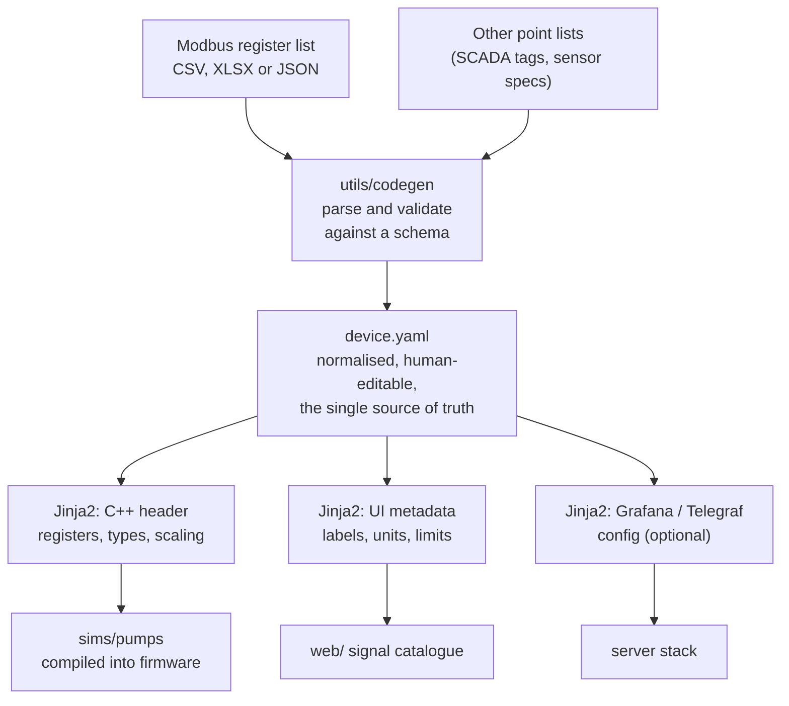
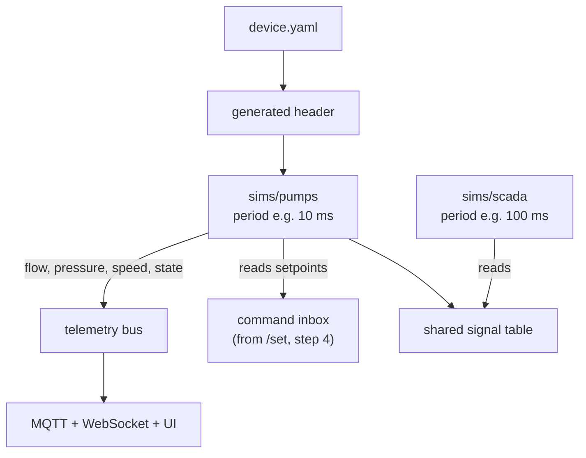
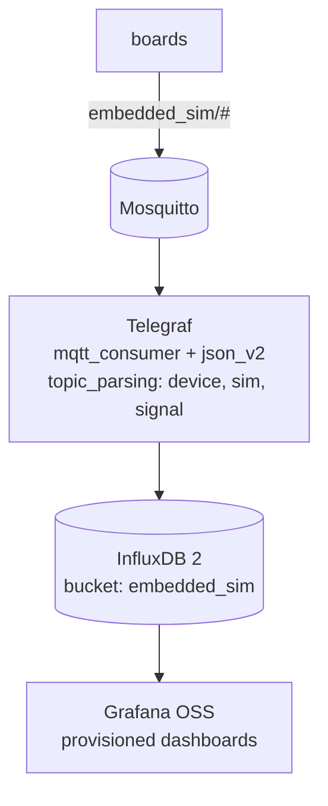
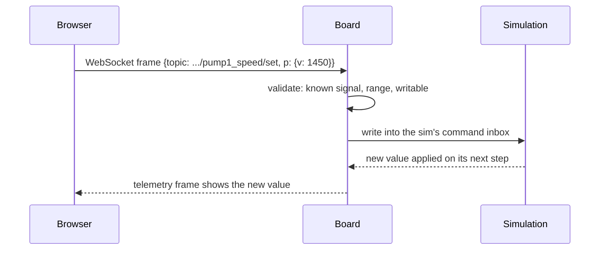
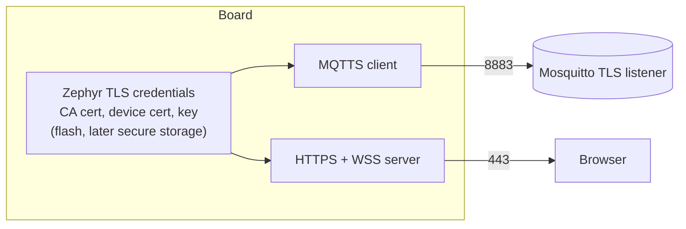
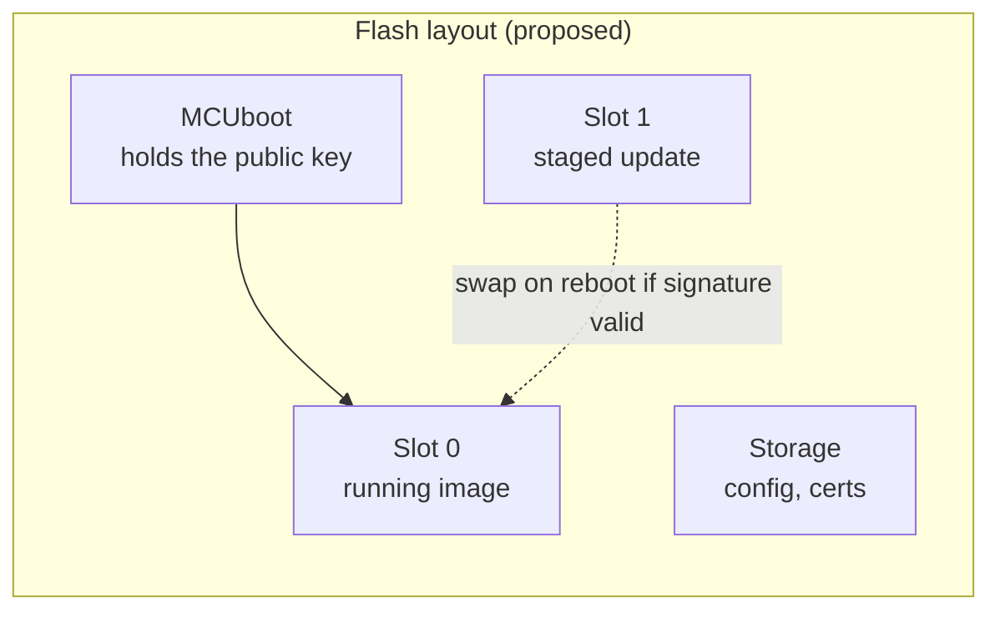
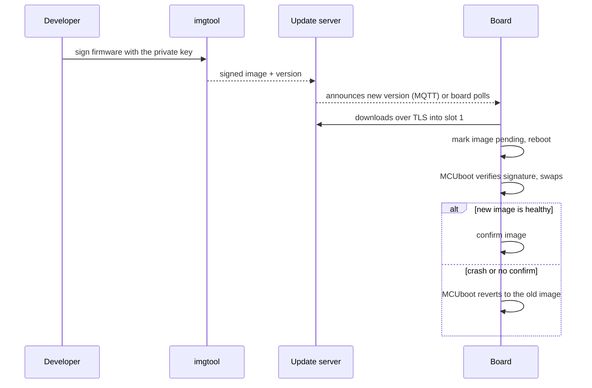

# Roadmap (planned)

Everything here is a **proposal**, not built. What exists today is in
[architecture.md](architecture.md). Each step is done one at a time, with open
questions settled with the project owner before code is written.

## 1. Where we are and what comes next

Order of work, with the reason for it:

| # | Step | Folder | Why this order |
|---|------|--------|----------------|
| 1 | Input processing (codegen) | `utils/` | every real device (pump, SCADA point list) starts as a file; without it we hard-code each device |
| 2 | Real sim models | `sims/pumps` first | proves the codegen, gives real data for the UI and dashboards |
| 3 | Dashboards pipeline | server side | Telegraf mapping is already specified in [mqtt.md](mqtt.md) |
| 4 | Commands from the UI | `net/ws`, `web/` | needs real models to be worth controlling |
| 5 | TLS | `net/tls` | MQTTS, then HTTPS/WSS; a prerequisite for a trustworthy OTA |
| 6 | Secure boot | `security/secureboot` | signed images, per board |
| 7 | OTA | `security/ota` | needs secure boot and TLS first |
| 8 | Tests and CI | `tests/` | host-side tests for payload, runner maths, codegen |

## 2. Step 1: input processing (`utils/`)

Goal: add a new device by dropping in its file, not by editing C++. Python with
Jinja2 templates (decided).

Open questions:
- What format does the first real modbus list come in (CSV, XLSX, JSON, a vendor PDF table), and which pump is it? One real example file decides the schema.
- Should the register map also drive a **Modbus TCP server on the board**, so SCADA clients can poll the simulated pump? (not decided; would add a `net/modbus/` module)
- Generated headers: committed to git, or generated at build time? (proposal: at build time, inputs in git)

## 3. Step 2: real simulation models

Open questions: process models (which equations / PLC-style logic), the periods
each sim needs, and whether sims exchange values on the board (a shared signal
table) or only through MQTT.

## 4. Step 3: dashboards pipeline

Tags come from the topic, so no firmware change is needed. Open question: should
the compose file and provisioned dashboards live in this repo (`deploy/`)?

## 5. Step 4: commands from the UI

The same `.../set` topic would also be accepted over MQTT. Open question:
authorisation. Without TLS and a login, anyone on the LAN could drive the
simulation (see step 5).

## 6. Step 5: TLS (`net/tls`)

Open questions: own CA (a script in `utils/`) versus self-signed per device; one
cert per device or a shared one; whether HTTPS is wanted on the board at all
(browsers then warn about a private CA), or only MQTTS.

## 7. Steps 6 and 7: secure boot and OTA

Proposal: MCUboot (Zephyr's standard bootloader) on both boards, signed images.

Open questions:
- Key handling: where the private signing key lives and who may sign.
- Trigger: pushed from the UI, announced over MQTT, or polled by the board.
- STM32U5 TrustZone and ESP32 flash encryption: use them or keep it to signature checks only.
- The ST67W611M1 module has its own signed firmware (T02, locked); it is updated separately from the host image ([stm32-wifi.md](stm32-wifi.md)).

## 8. Smaller items

| Item | Detail |
|------|--------|
| Kernel tick | raise `SYS_CLOCK_TICKS_PER_SEC` if a sim needs periods under 1 ms; measure jitter before and after |
| ESP32 first-boot reachability | after flashing, EN must be pressed once; root cause not found |
| ESP32 RAM headroom | DRAM1 is at 86%; TLS and real models will need budget, check with `ram_report` |
| `mosquitto.sh` | re-running `install` drops the WebSocket port 9001 mapping |
| MQTT sample drops | publish `dropped()` counts as an `rt` signal |
| Weak MQTT password | `embedded_sim` uses a trivial password; change it before exposing the broker |
| Tests | host-side unit tests (`native_sim`) for payload formatting and the runner's deadline arithmetic |
