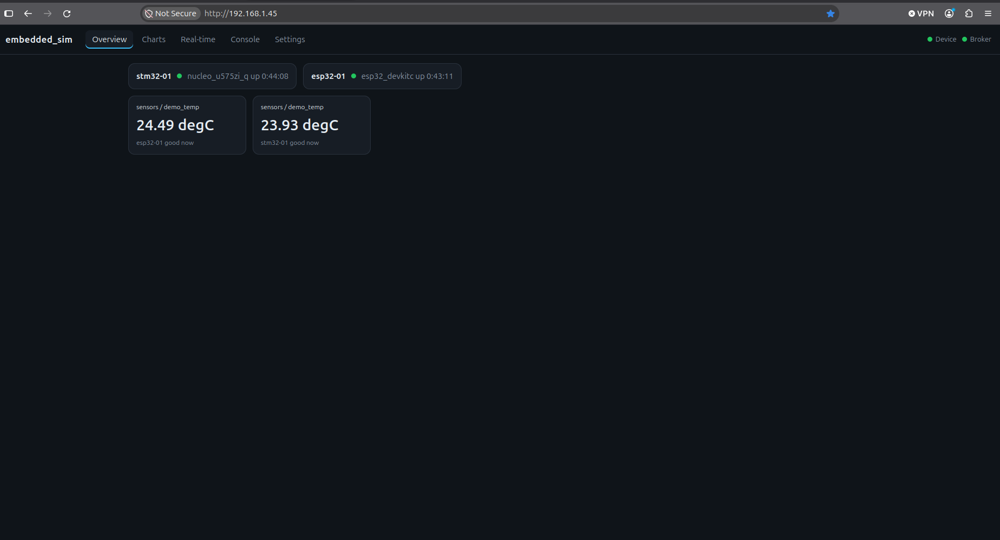
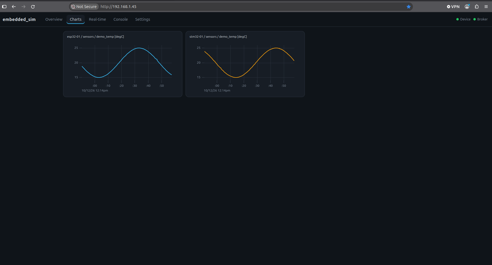
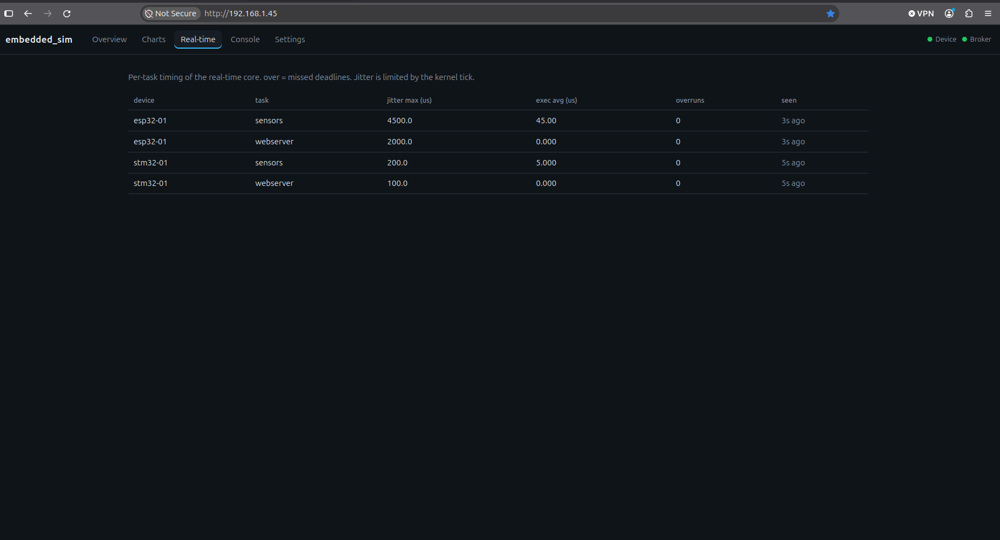
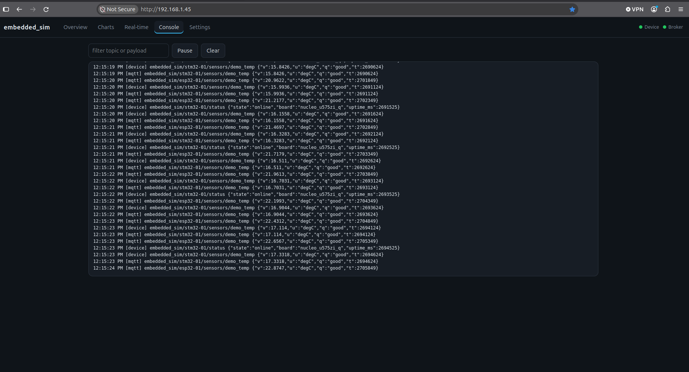
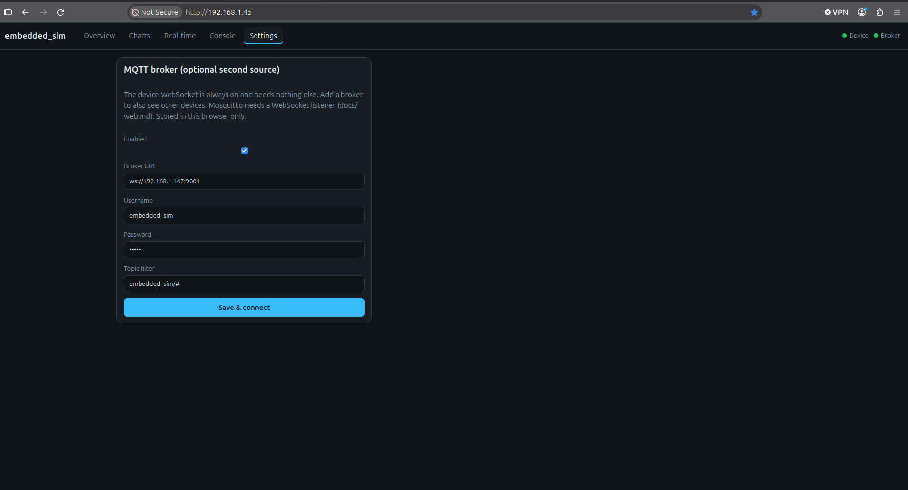

# Device-hosted web UI

The UI lives in the firmware, so a flashed board works on any network/HIL rig with no server.

```
browser ──HTTP──► board:80   /  /app.js  /app.css   (gzip, embedded in flash)
browser ──WS────► board:80   /ws                    live telemetry (primary source)
browser ──WS────► broker:9001                       optional second source (MQTT over WebSocket)
```

## Live protocol (`/ws`, device -> browser, text frames)

Same shape as an MQTT message, so both sources are handled identically:

```json
{"topic":"embedded_sim/stm32-01/sensors/demo_temp","p":{"v":20.3,"u":"degC","q":"good","t":123456}}
{"topic":"embedded_sim/stm32-01/status","p":{"state":"online","board":"nucleo_u575zi_q","uptime_ms":99000}}
```

Status is sent every second as a heartbeat. Up to `SIM_WS_MAX_CLIENTS` (4) browsers can watch at once; a new viewer evicts the oldest one when the table is full. Browser -> device commands are not implemented yet (planned: `.../set`).
If a sample arrives from both sources, duplicates are dropped by device-uptime `t`.

## Firmware

- `net/telemetry.*`: bus; sims call `net::telemetry::publish(sim, signal, Sample)`; sinks: MQTT, WebSocket.
- `net/ws/service.c`: Zephyr HTTP service + embedded files (C because of Zephyr macros). `net/ws/ws.cpp`: client table + fan-out thread.
- Files embedded: `web/dist/{index.html,app.js,app.css}`, or `web/fallback/` if `web/dist` is not built.

## Frontend (`web/`, TypeScript + Vite, deps: uPlot, mqtt.js)

## Tour of the UI

Screenshots of the page served by the STM32 (`http://192.168.1.45/`) with the
optional broker source enabled, so it shows both boards. The **Device** chip is
the board's own WebSocket, **Broker** is the MQTT-over-WebSocket source; green
means connected.

### Overview

One tile per signal, plus a card per device (online state, board, uptime).
Both boards appear on one page: `esp32-01` arrives through the broker.



### Charts

One live chart per numeric signal, kept for the last 600 samples. The placeholder
`demo_temp` signal is a 60 s sine wave, so the two boards' traces are phase
shifted by their boot time.



### Real-time

Timing health of the real-time core, per board and task. `jitter max` is the
worst lateness of a step start against its deadline, `exec avg` the mean step
duration, and `overruns` counts missed deadlines (red when above 0). Here the
ESP32 shows about 4.5 ms of jitter against 0.2 ms on the STM32, both with zero
overruns. Values refresh every `SIM_STATS_PERIOD_S` (10 s).



### Console

The raw frames as they arrive, with a topic/payload filter, Pause and Clear.
Every sample of the board serving the page appears twice, once as `[device]`
and once as `[mqtt]`; the store drops the duplicate (same device uptime `t`),
so charts and tiles show it once. The other board only appears as `[mqtt]`.



### Settings

Optional second source. The broker URL, user and password are stored in this
browser only (`localStorage`), never on the board. See the Mosquitto listener
section below for the broker side.



Tabs (details above): Overview (live tiles), Charts (one per signal), Real-time (task jitter/exec/overruns), Console (raw frames, filter/pause), Settings (optional broker).

```sh
sudo apt install -y nodejs npm      # once
scripts/web-build.sh                # -> web/dist, then rebuild the firmware to embed it
scripts/web-dev.sh 192.168.1.45     # live-reload UI against a real board
```

## Mosquitto WebSocket listener (only for the optional broker source)

Add to `~/stack/mosquitto/config/mosquitto.conf` and publish the port (`-p 9001:9001` in `mosquitto.sh`'s `docker run`):

```
listener 9001
protocol websockets
```
