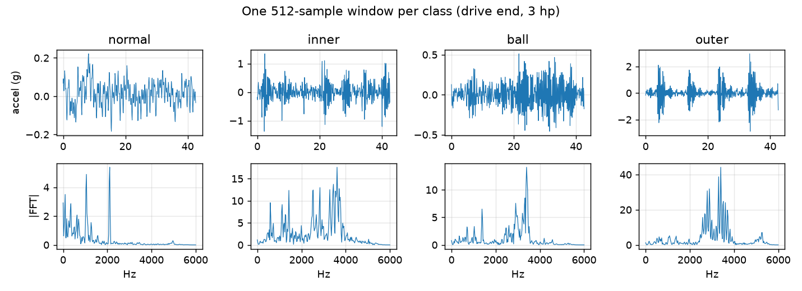
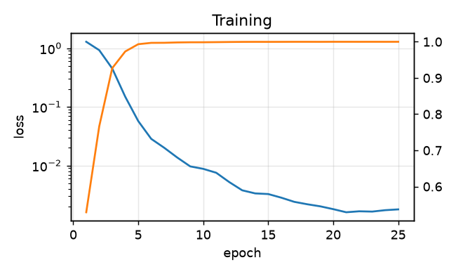
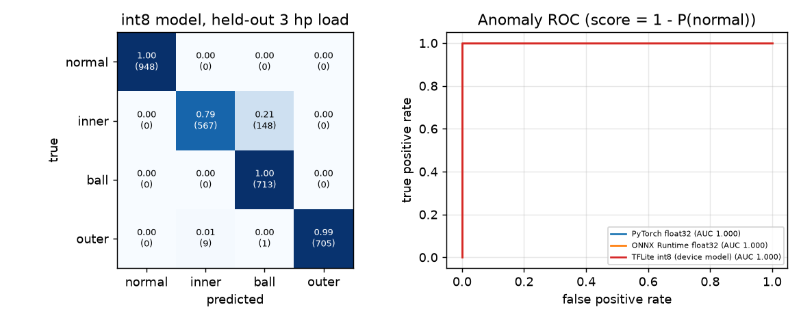
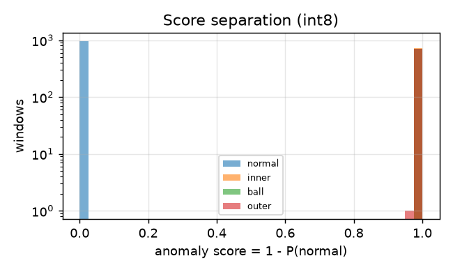

# python/: train and export the bearing-condition model

This folder trains a tiny 1-D CNN that classifies the health of a rotating machine's
bearing from accelerometer data, evaluates it, and exports it as an **int8 TFLite model**
that runs on the STM32U5 inside the `bearing_ai` simulation
([`sims/bearing_ai`](../sims/bearing_ai)). Why and how each step was done:
[docs/embedded-ai.md](../docs/embedded-ai.md).

## Data

[Case Western Reserve University bearing data](https://engineering.case.edu/bearingdatacenter)
(public benchmark). 12 kHz drive-end accelerometer, 4 motor loads (0-3 hp), 40 recordings:

| Class | Meaning | Recordings |
|---|---|---|
| `normal` | healthy bearing | 4 (one per load) |
| `inner` | inner-race fault, 0.007 / 0.014 / 0.021 in | 12 |
| `ball` | rolling-element fault, three sizes | 12 |
| `outer` | outer-race fault (6 o'clock), three sizes | 12 |



* **Window**: 512 samples (42.7 ms), z-score normalised per window (the MCU does the same maths).
* **Split by motor load, not by random window.** Train on 0, 1, 2 hp (50 % overlapping windows).
  Test on **3 hp**, a load the model never saw (non-overlapping windows, 3091 in total).
  A random split would leak near-identical overlapping windows into the test set and
  inflate the numbers.

## Model

`Conv(1->8, k16, s4) -> Conv(8->16, k8, s2) -> Conv(16->32, k8, s2) -> mean over time -> Linear(32->4)`,
each conv followed by BatchNorm + ReLU (BN is folded into the conv weights at export).
Only three TFLite ops are needed (`CONV_2D`, `MEAN`, `FULLY_CONNECTED`).

| Property | Value |
|---|---|
| Parameters | 5,548 |
| MACs / inference | 183,040 |
| `.tflite` size (int8) | 8.8 KiB |
| Window | 512 samples @ 12 kHz (42.7 ms) |

Anomaly detection and fault typing come from the same model: the **anomaly score is
`1 - P(normal)`**.



## Results (held-out 3 hp load)

| Model | Accuracy | Macro F1 | Anomaly AUROC |
|---|---|---|---|
| PyTorch float32 | 0.9537 | 0.9496 | 1.0000 |
| ONNX Runtime float32 | 0.9537 | 0.9496 | 1.0000 |
| TFLite int8 (the model on the board) | 0.9489 | 0.9442 | 1.0000 |

int8 and float32 agree on 99.45 % of windows; quantisation costs 0.5 points of accuracy.

| Class (int8) | Windows | Recall | Precision |
|---|---|---|---|
| normal | 948 | 1.0000 | 1.0000 |
| inner | 715 | 0.7930 | 0.9844 |
| ball | 713 | 1.0000 | 0.8271 |
| outer | 715 | 0.9860 | 1.0000 |





What this says, honestly:

* **Detecting that something is wrong is solved on this data**: no healthy window of
  the unseen load is flagged and every faulty window is (AUROC 1.0).
* **Telling the fault type is harder**: 21 % of unseen-load inner-race windows are
  labelled `ball`. This is the realistic weakness; it is the place to improve first
  (more capacity, spectral features, or training on more loads).
* CWRU is a clean lab benchmark (same machine, same sensors). Results on a different
  machine will be worse; this is a demonstration of the on-device pipeline, not a
  validated maintenance product. Faults of an unseen *size* were not tested.

## Reproduce

```bash
cd python
python3 -m venv .venv
.venv/bin/pip install torch --index-url https://download.pytorch.org/whl/cpu
.venv/bin/pip install -r requirements.txt

.venv/bin/python data/fetch_cwru.py     # 134 MB into data/raw/ (gitignored)
.venv/bin/python train.py               # ~8 min on a 4-core Celeron, CPU only
.venv/bin/python export.py              # artifacts/: .onnx and int8 .tflite
.venv/bin/python evaluate.py            # figures/ and artifacts/results.md
.venv/bin/python gen_firmware.py        # sims/bearing_ai/gen/: C array + replay windows
```

Everything under `artifacts/` and `figures/` is committed so the firmware builds without
retraining; `sims/bearing_ai/gen/` is the generated firmware input.

## Layout

| File | Role |
|---|---|
| `data/fetch_cwru.py` | download + file manifest (which recording is which class/load) |
| `bearing/data.py` | loading, windowing, normalisation, train/test split |
| `bearing/model.py` | the network |
| `train.py` | training (class-balanced sampling, AdamW, one-cycle LR, noise augmentation) |
| `export.py` | ONNX export, BN folding, int8 calibration, **hand-written TFLite flatbuffer** |
| `evaluate.py` | metrics for float / ONNX / int8, all figures and tables |
| `gen_firmware.py` | model -> C array, held-out windows -> replay bank |

### Why `export.py` writes the .tflite itself

The usual PyTorch -> ONNX -> TFLite route (`onnx2tf`, `ai-edge-torch`) needs TensorFlow,
whose prebuilt wheels require AVX. The development machine's CPU (Celeron N5095) has none,
so TensorFlow crashes with *illegal instruction*. The model is only three op types, so
`export.py` quantises it (TFLite int8 spec: per-channel symmetric conv weights, per-tensor
asymmetric activations, int32 bias) and writes the flatbuffer with the TFLite schema classes
that ship inside `ai-edge-litert`. `evaluate.py` then runs it through the reference TFLite
interpreter, which is what proves the file is valid. On a machine with AVX you can
replace `export.py` with `onnx2tf`; the rest of the pipeline is unchanged.
